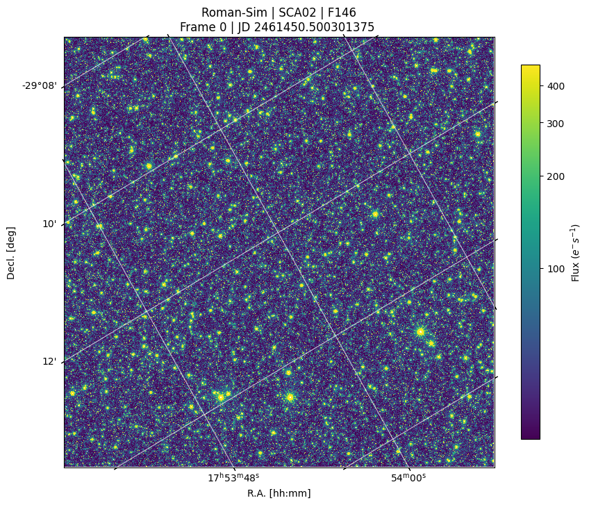
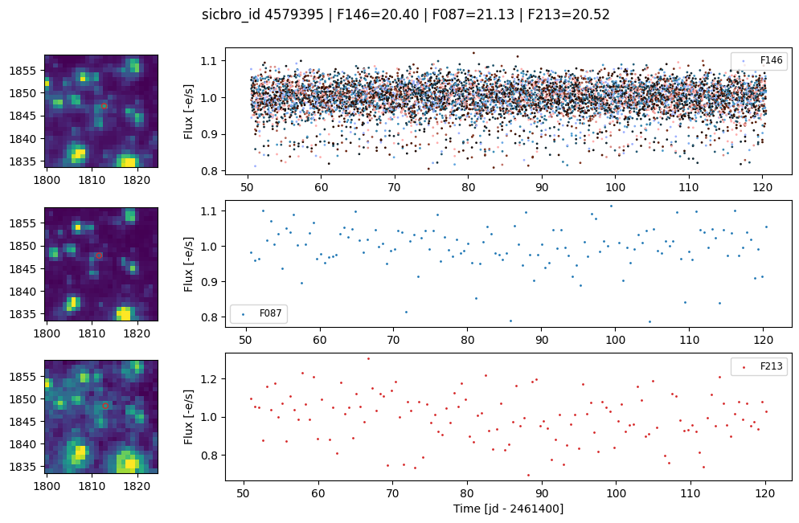

[](https://pypi.org/project/roman-lcs)
[](https://github.com/jorgemarpa/roman-lcs/actions/workflows/pytest.yaml)
[](https://github.com/jorgemarpa/roman-lcs/actions/workflows/mypy.yaml)
[](https://github.com/jorgemarpa/roman-lcs/actions/workflows/ruff.yaml)
[](https://github.com/jorgemarpa/roman-lcs/actions/workflows/deploy-mkdocs.yaml)

# roman-lcs

`roman-lcs` is a Python package designed for precision Pixel Response Function (PRF) and aperture photometry on time-series observations from the **Nancy Grace Roman Space Telescope Wide Field Instrument (WFI)**. Developed as part of the TRExS (Transiting and Relativistic Exoplanet Search) project, it provides high-throughput photometry pipelines, local background subtraction, crowding metrics, and light curve extraction for both simulated and in-flight Roman observations.

---

## About NASA Roman & the Galactic Bulge Time Domain Survey

The **Nancy Grace Roman Space Telescope** is NASA's new flagship observatory, engineered to explore the infrared universe with unprecedented speed and precision. Its primary imaging camera, the **Wide Field Instrument (WFI)**, combines 18 Sensor Chip Assemblies (SCAs) totaling 300 megapixels to yield a 0.281 deg² field of view—roughly 100 times that of the Hubble Space Telescope at comparable resolution (0.11 arcsec/pixel).

A cornerstone community initiative of Roman is the **Galactic Bulge Time Domain Survey (GBTDS)**. By continuously monitoring ~2 square degrees in the dense, dust-obscured Milky Way bulge with ~12-minute sampling over six 62-day seasons in the near-infrared, the GBTDS will detect tens of thousands of exoplanets via the transiting method, measure stellar variability across millions of light curves, and map Milky Way structure.

### The TRExS Project: Transits in the Roman Galactic EXoplanet Survey

**TRExS** ([Transits in the Roman Galactic EXoplanet Survey](https://www.stsci.edu/contents/events/roman/2023/november/transits-in-the-roman-galactic-exoplanet-survey-trexs)) is a Wide Field Science initiative and a Roman Cycle 1 designed to maximize the transit science return from Roman's GBTDS. While the GBTDS is nominally optimized for gravitational microlensing, its high-cadence time-series imaging of hundreds of millions of stars toward the Galactic Center makes it one of the most powerful transiting exoplanet surveys ever conceived.

Key pillars of TRExS include:
- **Massive Exoplanet Yields:** TRExS is predicted to discover between **~100,000 transiting exoplanets**, expanding the catalog of known exoplanets by orders of magnitude compared to Kepler and TESS.
- **Statistical Demographics of Rare Systems:** The enormous sample size places stringent demographic constraints on intrinsically rare planetary architectures, ultra-short-period planets, planets orbiting evolved or giant stars, and brown dwarf companions.
- **Galactic Depth & Diversity:** Probing deep through the Galactic disk into the inner bulge, TRExS observes stars across diverse stellar populations, metallicities, and Galactic environments, mapping how planet occurrence varies throughout the Milky Way.
- **Near-Infrared Atmospheres:** Leveraging Roman's near-infrared bandpass (WFI F146 and companion filters), TRExS enables direct atmospheric detection and thermal emission measurements (e.g., secondary eclipses and phase curves) for thousands of transiting giant planets at a population level.
- **Survey Synergy:** By pairing transit discoveries with microlensing detections in the same survey footprint, Roman and TRExS will establish a unified census of planetary systems spanning orbital separations from <0.1 AU out to free-floating planets.

Because the Galactic bulge is intensely crowded, precision forward-modeling Pixel Response Function (PRF) photometry and crowd-aware aperture photometry are essential. `roman-lcs` delivers this photometry engine within TRExS, turning target cutouts from `roman-cuts` and ePSF models from `roman-epsf` into calibrated, high-precision light curves.

---

## Installation

`roman-lcs` requires Python ≥ 3.11.

### User Installation with `pip`

Install the latest release from PyPI:

```bash
pip install roman-lcs
```

Or install from a local clone:

```bash
git clone https://github.com/jorgemarpa/roman-lcs.git
cd roman-lcs
pip install -e .
```

### Development Installation with `uv`

We recommend [uv](https://docs.astral.sh/uv/) for development. In development mode, `roman-lcs` links to local editable sibling checkouts of `roman-cuts` and `roman-epsf`:

```bash
# Clone the repository
git clone https://github.com/jorgemarpa/roman-lcs.git
cd roman-lcs

# Install all dependencies including development tools
uv sync --all-extras

# Run test suite
uv run pytest -v

# Run linting and type checking
uv run ruff check .
uv run mypy src/

# Build and preview documentation locally
uv run mkdocs serve
```

---

## Quickstart Guide

`roman-lcs` provides both a Python API centered around `LCExtractor` and command-line tools for batch light curve extraction.

### 1. Simulated Images

Simulated images are produced by the `RImTimSim` package. Cutouts prepared by `roman-cuts` are loaded directly into `LCExtractor` to fit the empirical or semi-analytical PRF model, subtract background, and evaluate multiple aperture radii.

#### Python Quickstart

```python
from roman_lcs import LCExtractor

# Step 1: Load time-series cutouts from an ASDF container created by roman-cuts
extractor = LCExtractor.from_asdf("target_cutout.asdf")

# Step 2: Perform PRF fitting and aperture photometry
extractor.fit_prf_photometry(
    targets=[0],               # Target star index in the catalog
    model_bkg=True,            # Model background scene
    do_aperture=True,          # Extract aperture photometry
    aperture_radius=3,         # Circular aperture radius in pixels
)

# Step 3: Export light curves and quality metrics to multi-extension FITS
extractor.to_fits("target_lightcurve.fits")
```

#### Simulated Image and PRF Model Examples

An example simulated full-frame image from `RImTimSim`:



Light curves are computed by fitting the PRF across every frame and saved into FITS files:



---

### 2. Roman Commissioning Data (`ROMCOM`)

`roman-lcs` seamlessly extracts light curves from Roman Commissioning observations using cutouts generated by `roman_cuts.com` and ePSF models generated by `roman-epsf`.

#### Python API for Commissioning Data

```python
from roman_lcs import LCExtractor

# 1. Load commissioning cutout cube (multi-extension ASDF with GWCS metadata)
extractor = LCExtractor.from_asdf("com_target_cutouts.asdf")

# 2. Attach an ePSF model (built from roman-epsf or stpsf)
extractor.set_prf_model("roman_epsf_sca02_F146.fits")

# 3. Fit PRF and compute aperture photometry with multiple aperture radii
extractor.fit_prf_photometry(
    targets=[0],
    model_bkg=True,
    do_aperture=True,
    aperture_radius=[2.0, 3.0, 4.0],
)

# 4. Save calibrated light curve with photometric precision metrics (RMS, P2P, CDPP)
extractor.to_fits("com_target_lightcurve.fits")
```

#### Command-Line Tools

`roman-lcs` includes command-line scripts for single and batch pipeline execution:

```bash
# Single target extraction
roman-lc-extract \
    --input com_target_cutouts.asdf \
    --output com_target_lightcurve.fits \
    --prf-file roman_epsf_sca02_F146.fits \
    --aperture-radius 3.0

# Batch extraction over directories (suitable for HPC / SLURM arrays)
roman-lc-extract-batch \
    --input-dir ./cutouts/ \
    --output-dir ./lightcurves/ \
    --prf-file roman_epsf_sca02_F146.fits \
    --max-workers 8
```

---

## Output FITS Data Structure

The generated FITS files contain:
- **`PRIMARY` Header**: Comprehensive metadata including target coordinates (RA, Dec), SCA ID, filter, observing program, cadence count, and pipeline version.
- **`EXT 1` (Binary Table)**: Time-series photometry columns:
  - `TIME`: Barycentric Julian Date / frame epoch
  - `PSF_FLUX`, `PSF_FLUX_ERR`: Optimal PRF-fitted flux and uncertainty
  - `APERTURE_*_FLUX`, `APERTURE_*_FLUX_ERR`: Aperture fluxes across configured radii
  - `CROWDSAP`: Crowding metric (ratio of target flux to total flux in aperture)
  - `FLFRCSAP`: PRF flux fraction enclosed within the aperture mask
  - `CENTROID_X`, `CENTROID_Y`: Fitted sub-pixel centroid coordinates
  - `QUALITY`: Data quality flag bitmask

---

## Changelog

See [CHANGELOG.md](https://github.com/jorgemarpa/roman-lcs/blob/main/CHANGELOG.md) for a complete release history.
